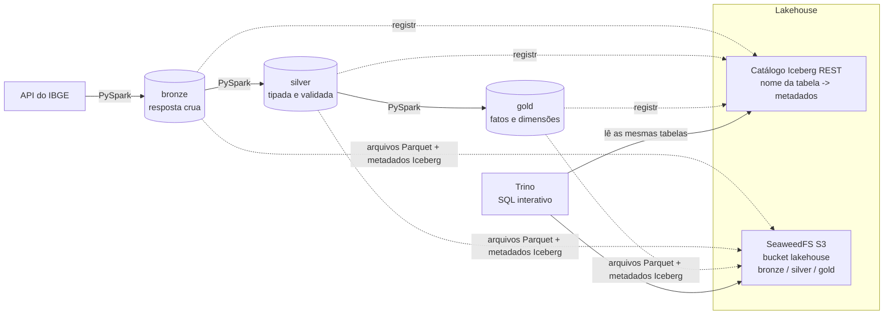

# Lakehouse IBGE: Iceberg + SeaweedFS + Spark + Trino

Projeto de estudo de engenharia de dados. Um lakehouse completo, local, com arquitetura medalhão
(bronze, silver, gold), todo em **tabelas Apache Iceberg**, usando dados reais e abertos do IBGE:
municípios de Pernambuco, população estimada e PIB.

A gold segue o modelo dimensional do livro *The Data Warehouse Toolkit* (Kimball e Ross, 3ª edição):
grão declarado, dimensões com chaves substitutas, dimensão tipo 2 (SCD2), registro "não informado",
dimensão de auditoria e dois fatos que compartilham dimensões conformadas.

## Arquitetura



| Peça | Papel |
|---|---|
| SeaweedFS | Armazenamento de objetos com API S3. Guarda os arquivos Parquet e os metadados do Iceberg |
| Iceberg | Formato de tabela: transações, snapshots, evolução de esquema, viagem no tempo |
| Catálogo REST | Diz qual é o metadado atual de cada tabela. Spark e Trino precisam usar o mesmo |
| Spark (PySpark) | Processamento: ingestão, limpeza, modelagem |
| Trino | Consulta SQL interativa sobre as tabelas |

## Começando

Pré-requisitos: Docker Desktop (ou Docker Engine) com Compose v2 e pelo menos 6 GB de RAM livres.

```bash
cp .env.example .env              # edite as duas chaves (so letras e numeros)
docker compose up -d              # SeaweedFS, catalogo e Trino
docker compose build spark        # so na primeira vez
docker compose run --rm spark python jobs/run_all.py
docker compose exec trino trino -f /sql/trino/02_consultas_gold.sql
```

O passo a passo completo, com o que esperar em cada etapa, está em
[docs/02-passo-a-passo.md](docs/02-passo-a-passo.md).

## Documentação

| Arquivo | Para quê |
|---|---|
| [docs/01-conceitos.md](docs/01-conceitos.md) | Entender cada peça e ligar com o livro |
| [docs/02-passo-a-passo.md](docs/02-passo-a-passo.md) | Subir, rodar, conferir, resolver problemas |
| [docs/03-apresentacao.md](docs/03-apresentacao.md) | Roteiro de apresentação, demo e perguntas prováveis |
| [docs/04-alteracoes.md](docs/04-alteracoes.md) | "Se pedirem X, faça Y": receitas de mudança |
| [docs/05-plano-de-estudo.md](docs/05-plano-de-estudo.md) | Estudar de verdade: leitura, exercícios, experimentos |
| [docs/06-modelo-gold.md](docs/06-modelo-gold.md) | Matriz de barramento, diagrama e dicionário da gold |
| [docs/07-auditoria-seguranca.md](docs/07-auditoria-seguranca.md) | Resultado da revisão de segurança |

## Estrutura

```
docker-compose.yml        stack: seaweedfs, s3-init, rest, trino, spark
config/                   credenciais S3 (modelo) e catalogo do Trino
lake/                     codigo: config, sessao, io, cliente IBGE, transformacoes, pipeline
jobs/                     scripts finos: 01 bronze, 02 silver, 03 gold, 04 demo SCD2, run_all
sql/trino/                consultas para explorar, analisar e olhar o Iceberg por dentro
tests/                    testes com Spark local e dados de exemplo
docs/                     guias
```

## O que foi testado

- **Testado:** toda a lógica de transformação (parse do JSON do IBGE, regras de qualidade, SCD2,
  chaves substitutas, fatos, recarga idempotente) com 16 testes em Spark local.
- **Não executado pelo autor:** a stack Docker (SeaweedFS, catálogo, Trino e a escrita em Iceberg).
  Os arquivos seguem a documentação oficial e exemplos publicados, e o `docker-compose.yml` passou na
  validação de sintaxe, mas a primeira execução real é a sua. O passo a passo diz o que esperar e a
  seção de problemas cobre as falhas mais prováveis.
- **Não testado contra a API real do IBGE:** o código lê o formato documentado. Se o IBGE mudar uma
  variável, o pipeline para com mensagem clara (veja `VARIAVEIS_PIB` em `lake/ibge.py`).

## Capturas de tela

Depois da primeira execução, salve em `docs/img/` e referencie aqui:

| Tela | Como obter |
|---|---|
| Estrutura do bucket | http://localhost:8888/buckets/lakehouse/ |
| Saída dos jobs | terminal depois de `run_all.py` |
| Consulta de drill across no Trino | http://localhost:8080 ou saída do CLI |
| Versões do SCD2 | saída de `jobs/04_demo_scd2.py` |

Antes de publicar, confira se as capturas não mostram chaves do `.env`.

## Segurança

Este projeto é para estudo local. As portas ficam em `127.0.0.1`, as chaves vêm do `.env`
(que não vai para o Git) e o catálogo é a imagem de teste do Iceberg, que não tem autenticação.
Não exponha essa stack na rede. Veja em [docs/04-alteracoes.md](docs/04-alteracoes.md) o que muda
para um ambiente real.
