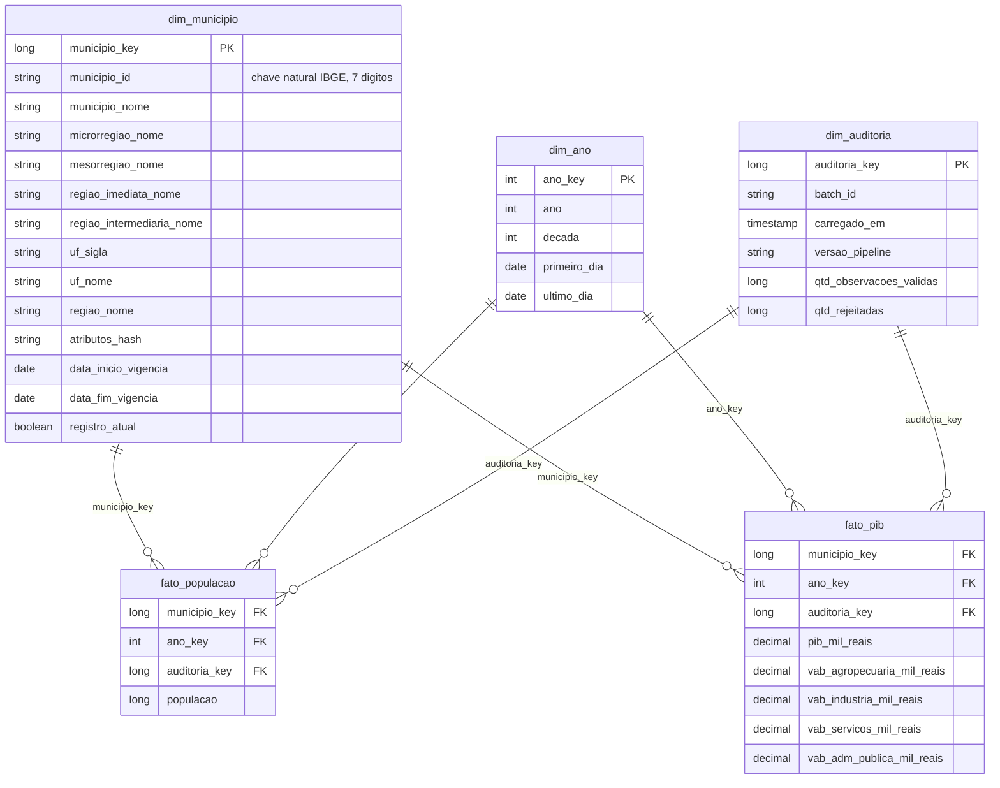

# 06. Modelo dimensional da gold

Referência rápida para apresentar e defender o modelo. Reflete o código em `lake/transforms.py` e
`lake/pipeline.py`.

## 1. Os quatro passos do projeto dimensional (Cap. 2; a granularidade está na p. 39)

| Passo | Decisão neste projeto |
|---|---|
| 1. Processo de negócio | Medição anual da população e da economia dos municípios (dados públicos do IBGE) |
| 2. Granularidade | **Um município por ano**, em cada fato |
| 3. Dimensões | Município, Ano, Auditoria |
| 4. Fatos | População (fato 1); PIB e valores adicionados (fato 2) |

Frase de granularidade para decorar: "cada linha de `fato_populacao` é a população estimada de um
município em um ano; cada linha de `fato_pib` é o PIB e o valor adicionado por setor de um município em
um ano".

## 2. Matriz de barramento

| Processo \ Dimensão | dim_municipio | dim_ano | dim_auditoria |
|---|:---:|:---:|:---:|
| fato_populacao | X | X | X |
| fato_pib | X | X | X |

As duas dimensões de negócio são **conformadas**: o mesmo município e o mesmo ano aparecem nos dois
fatos com os mesmos atributos. É isso que permite cruzar PIB com população (drill across, ver
`sql/trino/02_consultas_gold.sql`). Sem conformidade, o PIB per capita seria impossível de calcular
com segurança.

## 3. Diagrama

## 4. Dicionário de dados

### dim_municipio (SCD tipo 2)

| Coluna | Significado |
|---|---|
| municipio_key | Chave substituta. Sem significado de negócio; 0 é o membro "Não informado" |
| municipio_id | Chave natural do IBGE (7 dígitos, com zero à esquerda se necessário). Repete entre versões |
| municipio_nome, microrregiao_nome, mesorregiao_nome, regiao_imediata_nome, regiao_intermediaria_nome, uf_sigla, uf_nome, regiao_nome | Atributos descritivos, achatados (desnormalizados) na própria dimensão. Todos rastreados pelo SCD2 |
| atributos_hash | Resumo dos atributos rastreados. Se mudar, nasce uma nova versão |
| data_inicio_vigencia, data_fim_vigencia | Intervalo em que a versão vale. Versão aberta termina numa data-limite distante |
| registro_atual | Verdadeiro só na versão vigente |

### dim_ano

| Coluna | Significado |
|---|---|
| ano_key | Chave inteira igual ao ano (dimensão de calendário simples) |
| ano, decada, primeiro_dia, ultimo_dia | Atributos do calendário |

### dim_auditoria

Uma linha por execução da gold: lote de origem, momento da carga, versão do pipeline e contagens de
observações válidas e rejeitadas. Responde "de qual carga veio este número?" (Cap. 2, p. 66; Cap. 19, p. 460).

### fato_populacao

| Coluna | Tipo de medida |
|---|---|
| populacao | **Semi-aditiva**: soma entre municípios no mesmo ano, mas **não** soma entre anos (é um retrato, um estoque) |

### fato_pib

| Coluna | Tipo de medida |
|---|---|
| pib_mil_reais | Aditiva (fluxo anual, valores correntes, em mil reais) |
| vab_agropecuaria / industria / servicos / adm_publica_mil_reais | Aditivas. Valor adicionado bruto por setor; não são a soma total do PIB, porque o PIB também inclui impostos |

PIB per capita **não** é armazenado: é razão, não aditiva. Calcula-se na consulta como
`soma(pib) / soma(população)`, nunca como média dos per capitas (Cap. 2, p. 42: fatos não aditivos
devem ser guardados como componentes).

## 5. Decisões de projeto e justificativa

| Decisão | Por quê |
|---|---|
| SCD tipo 2 em todos os atributos do município | Preserva o contexto histórico (um fato de 2019 aponta para a versão vigente em 2019) |
| Chave substituta numérica | Isola o DW da chave de origem, suporta várias versões (Cap. 2, p. 46) |
| Membro 0 "Não informado" | Fato sem município válido não perde linha nem fica com chave nula (Cap. 2, p. 42, sobre nulos em chaves de fato) |
| Valores indisponíveis do IBGE ("-", "..", "...", "X") viram nulo com status | Nulo em medida é tratado corretamente por SUM, AVG e COUNT; a razão fica registrada |
| Dimensão desnormalizada (hierarquia na mesma tabela) | Estrela, não floco de neve: menos junções, mais legível (Cap. 2, p. 47) |
| Auditoria como dimensão | Rastreabilidade sem poluir os fatos |
| Fatos recarregados por ano (apagar e inserir) | Idempotência: rodar duas vezes dá o mesmo resultado |

## 6. Limitações (assuma na apresentação)

- Fatos anuais: só existe dimensão de ano; não há `dim_data` diária.
- Todos os atributos são tipo 2; não há mistura de tipos 1 e 2 (receita 8 do doc 04).
- Não há tabela ponte nem dimensão degenerada: o domínio não pede.
- Dados do IBGE são revisados retroativamente: a recarga do mesmo ano substitui os valores (não
  guardamos versões anteriores do fato; o histórico fica na viagem no tempo do Iceberg).
- Valores correntes: comparar anos distintos sem deflacionar mistura inflação com crescimento real.
